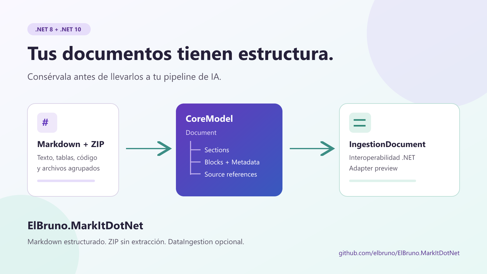
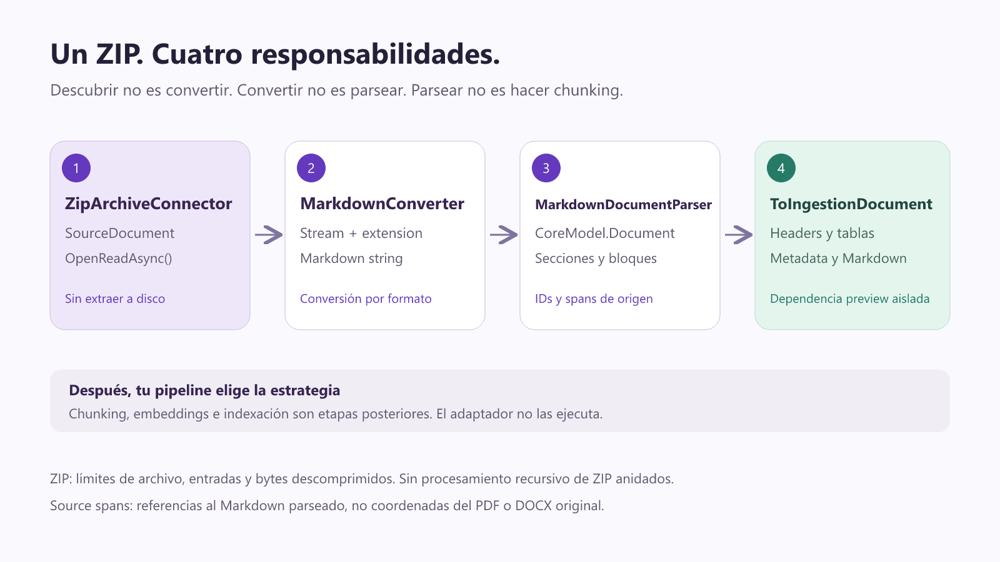

# De un ZIP a un documento listo para tu pipeline de IA, con C# y MarkItDotNet



> Borrador para publicar y promocionar posteriormente. El adaptador DataIngestion se distribuye como `0.9.3-preview.1`. Los ejemplos de Markdown y ZIP usan el código actual del repositorio y no requieren asumir que esas funcionalidades ya estén en un release estable.

Hola!

Convertir un PDF a Markdown está muy bien. Pero cuando estás preparando documentos para un pipeline de IA, aparece la siguiente pregunta: **¿qué hago con ese Markdown después?**

Un documento no es solamente una cadena de texto. Tiene títulos, secciones, tablas, listas, ejemplos de código y referencias al origen. Si aplanamos todo demasiado pronto, perdemos información que puede ser útil al decidir cómo dividirlo, enriquecerlo o mostrar una cita.

En [ElBruno.MarkItDotNet](https://github.com/elbruno/ElBruno.MarkItDotNet) agregué tres piezas para trabajar con ese siguiente paso: importación estructurada de Markdown con Markdig, un conector ZIP que no extrae archivos a disco y un adaptador opcional para `Microsoft.Extensions.DataIngestion`.

La idea no es implementar todo el pipeline de IA en una biblioteca. Es conectar bien sus etapas.

## Primero: qué está disponible y cómo probarlo

El adaptador `ElBruno.MarkItDotNet.DataIngestion` apunta a .NET 8 y .NET 10. Su dependencia de Microsoft está en preview y queda aislada del CoreModel.

Para probar **el adaptador publicado** en una aplicación nueva:

```powershell
dotnet new console -n AdapterDemo -f net10.0
Set-Location AdapterDemo
dotnet add package ElBruno.MarkItDotNet.DataIngestion --version 0.9.3-preview.1
```

Este comando usa el SDK de .NET 10. El adaptador también incluye un target para .NET 8. CoreModel llega como dependencia del adaptador. No es necesario instalar el paquete completo de pipelines de Microsoft para ejecutar `ToIngestionDocument()`.

Para probar **las tres piezas juntas**, el repositorio incluye una demo ejecutable que usa referencias a proyectos:

```powershell
git clone https://github.com/elbruno/ElBruno.MarkItDotNet.git
Set-Location ElBruno.MarkItDotNet
dotnet run --project src\samples\MarkdownIngestionDemo\MarkdownIngestionDemo.csproj --framework net8.0
```

La demo genera su propio ZIP de prueba con Markdown, JSON y texto, procesa sus entradas y elimina ese archivo temporal al terminar. No necesita servicios de IA, claves API ni documentos privados.

## 1. El adaptador, en un ejemplo que funciona solo con NuGet

Voy a empezar por lo más pequeño: construir un documento y adaptarlo.

Este programa completo puede reemplazar el `Program.cs` de `AdapterDemo`:

```csharp
using ElBruno.MarkItDotNet.CoreModel;
using ElBruno.MarkItDotNet.DataIngestion;

var model = new Document
{
    Id = "release-notes",
    Metadata = new DocumentMetadata
    {
        Title = "Release notes",
        SourceFormat = "generated"
    },
    Sections =
    [
        new DocumentSection
        {
            Id = "changes",
            Heading = new HeadingBlock
            {
                Id = "changes-heading",
                Text = "Changes",
                Level = 2
            },
            Blocks =
            [
                new ParagraphBlock
                {
                    Id = "intro",
                    Text = "Documents now have structure."
                }
            ]
        }
    ]
};

var ingestion = model.ToIngestionDocument();

Console.WriteLine($"Identifier: {ingestion.Identifier}");
foreach (var element in ingestion.EnumerateContent())
{
    Console.WriteLine($"{element.GetType().Name}: {element.GetMarkdown()}");
}
```

El resultado mantiene el identificador del documento. El título pasa a un encabezado de nivel 1; el encabezado de la sección y el párrafo se convierten en elementos nativos de Microsoft.

No hay una llamada a un LLM escondida aquí. No hay embeddings ni indexación automática. Es un cambio de representación para que otros componentes puedan consumir el documento.

## 2. Markdown deja de ser solamente un string

En la demo del repositorio, este Markdown es nuestra entrada:

````markdown
# Deployment guide

## Configuration

Use **environment variables** for configuration.

| Setting | Value |
| --- | --- |
| Mode | Preview |

## Checklist

- [x] Build the application
- [ ] Review the deployment

```csharp
Console.WriteLine("Ready!");
```

> Review before deploying.
````

La nueva API de importación es intencionalmente pequeña:

```csharp
using ElBruno.MarkItDotNet.Markdown;

var model = MarkdownDocumentParser.Parse(markdown, "docs/deployment.md");

Console.WriteLine($"Title: {model.Metadata.Title}");
Console.WriteLine($"Format: {model.Metadata.SourceFormat}");
Console.WriteLine($"Document ID: {model.Id}");
```

Markdig interpreta CommonMark y sus extensiones avanzadas. El parser transforma el resultado en `Document`, `DocumentSection` y bloques del CoreModel.

El primer H1 inicial se usa como título. Los demás encabezados forman la jerarquía de secciones. Los párrafos, tablas, listas, código y citas tienen representaciones propias; el contenido de bloques no modelados se conserva como Markdown crudo.

Eso también significa que el conversor Markdown existente mantiene su comportamiento: **la importación estructurada es opcional**, no un reemplazo obligatorio del pass-through.

### Recorrer las secciones sin perder su jerarquía

No alcanza con leer `model.Sections`: las secciones pueden tener subsecciones. Este helper recorre ambas:

```csharp
using ElBruno.MarkItDotNet.CoreModel;

static void PrintSections(
    IReadOnlyList<DocumentSection> sections,
    int depth = 0)
{
    foreach (var section in sections)
    {
        var indent = new string(' ', depth * 2);
        Console.WriteLine($"{indent}Section: {section.Heading?.Text ?? "(root)"}");

        foreach (var block in section.Blocks)
        {
            Console.WriteLine($"{indent}  {block.GetType().Name}, ID: {block.Id}");
        }

        PrintSections(section.SubSections, depth + 1);
    }
}

// Dentro de tu programa:
// PrintSections(model.Sections);
```

En la entrada de ejemplo aparecen `ParagraphBlock`, `TableBlock`, `ListBlock`, `CodeBlock` y `QuoteBlock`.

### Inspeccionar un checklist

Para nuestro documento de ejemplo, `Checklist` es una sección de primer nivel:

```csharp
var checklist = model.Sections.Single(
    section => section.Heading?.Text == "Checklist");

var tasks = checklist.Blocks.OfType<ListBlock>().Single();
foreach (var item in tasks.Items)
{
    Console.WriteLine($"{item.Text}: checked={item.IsChecked}");
}
```

`IsChecked` es nullable: `true` y `false` corresponden a tareas; `null` identifica un ítem de lista convencional.

## 3. Guardar estructura y volver a generar Markdown

Para inspeccionar el modelo completo, serializarlo a JSON es una buena opción:

```csharp
using System.Text.Json;

var json = JsonSerializer.Serialize(
    model,
    new JsonSerializerOptions { WriteIndented = true });

Console.WriteLine(json);
```

Los bloques usan discriminadores polimórficos como `$type`. El JSON permite ver qué parte del contenido es un párrafo, una tabla o un bloque de código, además de sus IDs y referencias de origen.

Y podemos volver a Markdown:

```csharp
using ElBruno.MarkItDotNet.CoreModel;

var rendered = MarkdownRenderer.Render(model);
Console.WriteLine(rendered);
```

Hay una distinción importante: `OriginalMarkdown` conserva la sintaxis del **bloque**, por ejemplo negritas, enlaces o cercas de código. El renderer prioriza ese valor cuando existe.

Esto no promete una reproducción byte por byte del archivo completo: se pueden normalizar separaciones entre bloques, saltos de línea y el título. Tampoco promete que editar `Text` invalide automáticamente `OriginalMarkdown`.

Si quiero reemplazar un párrafo parseado, hago explícita esa decisión:

```csharp
var paragraph = model.Sections
    .SelectMany(section => section.Blocks)
    .OfType<ParagraphBlock>()
    .First();

var edited = paragraph with
{
    Text = "Use managed configuration for production.",
    OriginalMarkdown = null
};

Console.WriteLine(edited.Text);
```

`with` crea un bloque nuevo; para renderizar el documento modificado hay que incorporarlo a una nueva sección o documento. El bloque original no cambia.

## 4. ZIP como fuente de documentos, no como carpeta temporal



Un ZIP suele llegar como un paquete de documentación: guías, notas, archivos JSON o reportes. El conector expone sus archivos como `SourceDocument` a través de `IDocumentSource`.

```csharp
using ElBruno.MarkItDotNet.Connectors;
using Microsoft.Extensions.Logging.Abstractions;

var source = new ZipArchiveConnector(
    new ZipArchiveConnectorOptions
    {
        ArchivePath = "documents.zip",
        MaxArchiveSizeBytes = 10 * 1024 * 1024,
        MaxEntrySizeBytes = 2 * 1024 * 1024,
        MaxTotalUncompressedBytes = 20 * 1024 * 1024,
        MaxEntries = 100
    },
    NullLogger<ZipArchiveConnector>.Instance);

using var timeout = new CancellationTokenSource(TimeSpan.FromSeconds(30));

await foreach (var document in source.GetDocumentsAsync(timeout.Token))
{
    Console.WriteLine(document.Name);
    Console.WriteLine(document.Source);
    Console.WriteLine(document.Metadata[SourceMetadataKeys.ArchiveEntryPath]);

    await using var content = await document.OpenReadAsync(timeout.Token);
    // Consumir el stream aqui, antes de salir de esta iteracion.
}
```

La enumeración descubre los archivos. `OpenReadAsync()` abre su contenido cuando lo necesito. El stream mantiene vivo el archivo ZIP hasta que se dispone.

Las entradas de directorio no se devuelven como documentos. Los nombres de entrada se usan como referencias y **no se convierten en rutas de extracción**.

Para aplicaciones que usan dependency injection:

```csharp
using ElBruno.MarkItDotNet.Connectors;
using Microsoft.Extensions.DependencyInjection;

var services = new ServiceCollection();
services.AddZipArchiveConnector(options =>
{
    options.ArchivePath = "documents.zip";
    options.MaxEntries = 100;
    options.MaxEntrySizeBytes = 2 * 1024 * 1024;
});

using var provider = services.BuildServiceProvider();
var source = provider.GetRequiredService<IDocumentSource>();
```

Ese ejemplo de DI requiere además `Microsoft.Extensions.DependencyInjection`, el contenedor concreto. El paquete de conectores proporciona las extensiones y abstracciones, no ese contenedor.

### Los límites importan

| Opción | Valor por defecto | Qué controla |
| --- | --- | --- |
| `MaxArchiveSizeBytes` | 100 MiB | Tamaño comprimido del archivo en descubrimiento |
| `MaxEntrySizeBytes` | 25 MiB | Tamaño declarado por entrada y tope durante las lecturas |
| `MaxTotalUncompressedBytes` | 250 MiB | Suma de tamaños declarados de entradas elegibles |
| `MaxEntries` | 10.000 | Cantidad de entradas, incluidos directorios |

Las entradas que superan el límite individual se omiten con un warning. Si se supera el tamaño del archivo, la cantidad de entradas o el total elegible, el conector rechaza la operación.

La lectura tiene un tope individual adicional. El límite total no es un contador compartido de todas las lecturas concurrentes o repetidas; es un control de descubrimiento basado en los tamaños declarados.

No conviene anunciar esto como una protección universal contra ZIP maliciosos. No hay extracción recursiva de ZIP anidados, ni un presupuesto de CPU de descompresión, ni un límite configurable de ratio de compresión. En producción seguiría usando límites de concurrencia, aislamiento y políticas propias para archivos no confiables.

## 5. ZIP, conversión, parser y adaptador: el flujo completo

Las cuatro etapas se pueden conectar sin escribir archivos intermedios:

```csharp
using ElBruno.MarkItDotNet;
using ElBruno.MarkItDotNet.DataIngestion;
using ElBruno.MarkItDotNet.Markdown;

var converter = new MarkdownConverter();
var allowedExtensions = new HashSet<string>(StringComparer.OrdinalIgnoreCase)
{
    ".md", ".txt", ".json"
};

await foreach (var document in source.GetDocumentsAsync(timeout.Token))
{
    var extension = Path.GetExtension(document.Name);
    if (!allowedExtensions.Contains(extension))
    {
        Console.WriteLine($"Skipped unsupported document: {document.Name}");
        continue;
    }

    await using var content = await document.OpenReadAsync(timeout.Token);
    var convertedMarkdown = await converter.ConvertAsync(
        content, extension, timeout.Token);

    var structured = MarkdownDocumentParser.Parse(
        convertedMarkdown, document.Source);

    var ingestionDocument = structured.ToIngestionDocument();

    Console.WriteLine(
        $"{document.Name}: {ingestionDocument.EnumerateContent().Count()} elements");
}
```

Este fragmento reutiliza `source` y `timeout` del ejemplo anterior. El programa completo está en la demo.

La allowlist es una decisión de la aplicación. Podemos ampliarla a formatos de los conversores registrados, pero un ZIP no hace que todos sus contenidos sean compatibles por arte de magia.

También hay un detalle de trazabilidad: el `sourcePath` incluye el archivo ZIP y la entrada, pero los offsets que produce el parser apuntan al **Markdown convertido**, no a posiciones equivalentes del PDF o DOCX original.

Y otra precisión: sin archivos intermedios no significa memoria constante. El conversor produce un string y el parser construye un árbol; el ZIP solo evita extraer todas las entradas a disco.

## 6. Tablas nativas, no solamente texto con barras

Para el adaptador, una tabla se convierte en `IngestionDocumentTable` con una matriz de celdas:

```csharp
using Microsoft.Extensions.DataIngestion;

var ingestion = model.ToIngestionDocument();
var table = ingestion.EnumerateContent()
    .OfType<IngestionDocumentTable>()
    .Single();

Console.WriteLine($"Rows: {table.Cells.GetLength(0)}");
Console.WriteLine($"Columns: {table.Cells.GetLength(1)}");
Console.WriteLine($"Header: {table.Cells[0, 0]?.Text}");
Console.WriteLine($"Value: {table.Cells[1, 1]?.Text}");
```

Para nuestra entrada, la primera fila contiene `Setting` y `Value`; la segunda contiene `Mode` y `Preview`.

Esto deja la estructura disponible para componentes posteriores que necesiten tratar las tablas de manera diferente a un párrafo.

## 7. IDs y origen también viajan

Los metadatos del adaptador usan el prefijo `markitdotnet.`:

```csharp
var root = ingestion.Sections.Single();

Console.WriteLine(root.Metadata["markitdotnet.documentId"]);
Console.WriteLine(root.Metadata["markitdotnet.sourceFormat"]);

foreach (var element in ingestion.EnumerateContent())
{
    if (element.Metadata.TryGetValue("markitdotnet.blockId", out var blockId))
    {
        Console.WriteLine($"Block: {blockId}");
    }

    if (element.Metadata.TryGetValue("markitdotnet.sourceOffset", out var offset))
    {
        Console.WriteLine($"Markdown offset: {offset}");
    }

    if (element.Metadata.TryGetValue("markitdotnet.sourcePath", out var path))
    {
        Console.WriteLine($"Source: {path}");
    }
}
```

La metadata del documento se guarda en la sección raíz. Las referencias del bloque se guardan en su elemento correspondiente; `PageNumber` también se copia cuando existe.

El ID generado por el parser es determinista para el mismo contenido y source path. Eso no implica que permanezca igual después de editar el archivo, moverlo o cambiar el Markdown convertido.

Las listas, citas y bloques de código no tienen todos un equivalente nativo específico en este adaptador: se representan como párrafos con Markdown y metadata del tipo de bloque. La jerarquía interna de cada lista o cita no se vuelve una jerarquía de elementos de Microsoft.

## ¿Por qué un paquete opcional?

Porque no todos los consumidores necesitan la misma cosa.

Si quiero convertir un archivo a Markdown, sigo usando el paquete principal. Si quiero inspeccionar la estructura de Markdown, uso el parser opcional. Si quiero integrar CoreModel con componentes de Microsoft, agrego DataIngestion.

El adaptador referencia `Microsoft.Extensions.DataIngestion.Abstractions`. No vuelve a parsear Markdown con el lector de Microsoft ni obliga a la biblioteca base a depender de un API preview.

El resultado es un límite de responsabilidad bastante claro: **MarkItDotNet prepara y representa documentos; tu aplicación decide cómo usarlos**.

## Para probarlo y seguir el proyecto

El ejemplo completo de este artículo está en [MarkdownIngestionDemo](../src/samples/MarkdownIngestionDemo/Program.cs). Se puede ejecutar en .NET 8 o .NET 10 cambiando `--framework`.

La [guía de importación Markdown](markdown-import.md), la [guía del conector ZIP](zip-connector.md) y la [guía del adaptador](data-ingestion.md) explican cada API por separado.

El código y los paquetes están aquí:

- [Repositorio de ElBruno.MarkItDotNet](https://github.com/elbruno/ElBruno.MarkItDotNet).
- [Adaptador DataIngestion 0.9.3-preview.1 en NuGet](https://www.nuget.org/packages/ElBruno.MarkItDotNet.DataIngestion/0.9.3-preview.1).
- [Microsoft.Extensions.DataIngestion](https://learn.microsoft.com/dotnet/dataingestion/microsoft-extensions-dataingestion).

Si estás preparando documentos para IA con C#, prueba la demo. A veces el siguiente paso útil no es agregar otra llamada al modelo: es conservar mejor la estructura que ya tienen tus documentos.

Saludos!

Bruno

## Material para la promoción posterior

**Título corto:** Markdown + ZIP + DataIngestion: documentos estructurados con C#.

**Extracto:** ElBruno.MarkItDotNet incorpora importación estructurada de Markdown, lectura de ZIP sin extracción y un adaptador opcional para Microsoft.Extensions.DataIngestion. Una demo ejecutable conecta las tres etapas con C#.

**Texto para redes:** Un documento no es solo un string. Con ElBruno.MarkItDotNet puedes conservar secciones, tablas y referencias de origen, leer entradas ZIP sin extraerlas a disco y adaptar CoreModel a IngestionDocument. El adaptador está en preview; el repo incluye una demo completa. Código: https://github.com/elbruno/ElBruno.MarkItDotNet

**Imágenes:** portada y diagrama originales en PNG, con fuentes SVG editables en `images/`. Al publicar fuera de GitHub, subir las dos imágenes y reemplazar las rutas relativas de este borrador por las URLs del blog.

**Nota editorial:** artículo preparado con ayuda de IA; ejemplos contrastados con las APIs del repositorio. Revisar las versiones publicadas de Markdown y Connectors antes de convertir las instrucciones desde source en instrucciones de instalación por NuGet.
